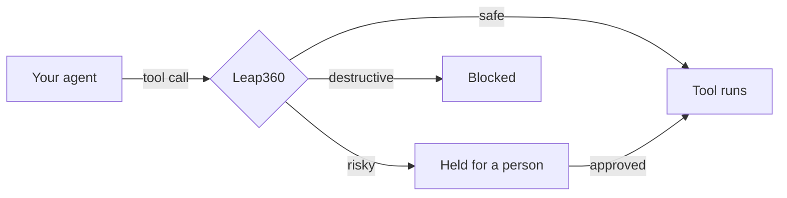

<div align="center">

# Leap360 AI

**The security layer for your AI agents.** Check every tool call before it runs.

[](https://www.npmjs.com/package/leap360)
[](https://pypi.org/project/leap360)
[](LICENSE)

[Website](https://leap360.ai) · [Console](https://leap360.ai/dashboard) · [TypeScript docs](typescript/README.md) · [Python docs](python/README.md)

</div>

---

AI agents can send email, issue refunds, write to databases and deploy code. Leap360 sits between your agent and its
tools and decides, before each call runs, whether to **Allow** it, **Hold** it for a person to approve, or **Block** it.
**Stop all** halts every agent at once.



## Contents

1. [Choose how to run it](#1-choose-how-to-run-it)
2. [Install](#2-install)
3. [Set up on your own device (no account)](#3-set-up-on-your-own-device-no-account)
4. [Set up with the Leap360 cloud](#4-set-up-with-the-leap360-cloud)
5. [Protect an MCP server](#5-protect-an-mcp-server)
6. [Change the rules](#6-change-the-rules)
7. [Command reference](#7-command-reference)
8. [Troubleshooting](#8-troubleshooting)

## 1. Choose how to run it

| | On your device | With the Leap360 cloud |
| --- | --- | --- |
| Account or API key | Not needed | Needed ([sign up](https://leap360.ai)) |
| Where decisions happen | In your process | In your process for allowed calls; the cloud for held and blocked ones |
| Where rules, Stop all and the log live | Files in `~/.leap360/local` | The console |
| Approve held calls | From the terminal on the same machine | From the console, by anyone on your team |
| Leaves your machine | Nothing | Tool names, argument keys and risk by default ([what is sent](typescript/README.md#privacy-what-leaves-your-process)) |

Your code is the same either way. You can start on your device and move to the cloud later by setting an API key.

## 2. Install

You need Node.js 18 or later, or Python 3.9 or later.

```bash
npm install leap360        # TypeScript / JavaScript
pip install leap360        # Python
```

## 3. Set up on your own device (no account)

**Step 1. Turn on local mode.**

```bash
export LEAP360_LOCAL=1                  # macOS / Linux
$env:LEAP360_LOCAL = "1"                # Windows PowerShell
```

Or pass `local: true` (TypeScript) or `local=True` (Python) in code, as below.

**Step 2. Wrap the functions your agent can call.**

TypeScript:

```ts
import { Leap360 } from 'leap360';

const leap = new Leap360({ local: true, projectId: 'my-app', serviceName: 'support-bot' });

const refundCustomer = leap.wrapTool('refund_customer', async ({ orderId, amount }) => {
  // your real refund code
});
const runSql = leap.wrapTool('run_sql', async ({ query }) => db.query(query));

// Give refundCustomer and runSql to your agent framework instead of the raw functions
```

Python:

```python
from leap360 import Leap360Governor

leap = Leap360Governor(agent_name="support-bot", local=True)

@leap.wrap_tool("refund_customer")
def refund_customer(order_id: str, amount: float):
    ...  # your real refund code

@leap.wrap_tool("run_sql")
def run_sql(query: str):
    ...
```

**Step 3. Run your agent.** On the first call Leap360 creates `~/.leap360/local/rules.json` with the safe default rules:

| Rule | Does |
| --- | --- |
| Block destructive actions | Blocks dropping tables, `rm -rf`, deleting Kubernetes resources, destroying infrastructure |
| Hold payments and refunds | Holds them for you to approve |
| Hold permission and secret changes | Holds them for you to approve |
| Hold deploys and releases | Holds them for you to approve |

A blocked or held call does not run. Your code gets `Leap360ActionBlockedError` (TypeScript) or `ActionBlocked`
(Python), with `code` set to `ACTION_BLOCKED` or `APPROVAL_REQUIRED`.

**Step 4. Approve a held call.** In a second terminal:

```bash
npx leap360 local approvals             # lists held calls with their id
npx leap360 local approve k3x9q2        # that exact call may now run for 15 minutes
```

Run the call again and it goes through. Python users without Node.js can use `python -m leap360.local approvals`
and `python -m leap360.local approve <id>`: both read the same files.

**Step 5. Try Stop all.**

```bash
npx leap360 local stop                  # every agent on this device stops within a second
npx leap360 local resume
```

**Step 6. See what happened.**

```bash
npx leap360 local log
```

Not ready to block anything yet? Run `npx leap360 local mode watch`: every call runs, and the log shows what would
have been held or blocked. Switch back with `npx leap360 local mode enforce`.

## 4. Set up with the Leap360 cloud

**Step 1.** Create an account at [leap360.ai](https://leap360.ai). The 14-day trial needs no card.

**Step 2.** Sign in from your project folder. This opens the browser and saves your API key on this machine:

```bash
npx leap360 login
```

On a server or in CI, set the key from the console instead: `export LEAP360_API_KEY=your_key`.

**Step 3.** Wrap your tools as in [step 2 above](#3-set-up-on-your-own-device-no-account), without `local`:

```ts
const leap = new Leap360({ apiKey: process.env.LEAP360_API_KEY, projectId: 'my-app', serviceName: 'support-bot' });
```

```python
leap = Leap360Governor(agent_name="support-bot")  # reads LEAP360_API_KEY
```

**Step 4.** Run your agent. Its calls appear in the console under **Live activity**. New projects start in
**Watch** mode, so nothing is blocked until you turn blocking on. Approve held calls and use **Stop all** from the console.

## 5. Protect an MCP server

Put any MCP server behind Leap360 without changing its code. In the MCP config of Claude Code, Cursor or Claude Desktop,
put `leap360 mcp-proxy` in front of the server's own command:

```json
{
  "mcpServers": {
    "github": {
      "command": "npx",
      "args": ["-y", "leap360", "mcp-proxy", "--local", "--agent", "claude-code", "--",
               "npx", "-y", "@modelcontextprotocol/server-github"]
    }
  }
}
```

Leave out `--local` to use the cloud (it then needs `LEAP360_API_KEY` or `npx leap360 login`).

## 6. Change the rules

On your device, edit `~/.leap360/local/rules.json`. Changes apply on the next call, without a restart.

```json
{
  "mode": "enforce",
  "capture": "redacted",
  "policies": [
    { "name": "Block destructive actions", "action": "block",
      "match": { "categories": ["db.destructive", "infra.destroy", "k8s.delete", "fs.delete"] } },
    { "name": "Hold email to customers", "action": "ask_admin",
      "match": { "tools": ["send_email*"] } },
    { "name": "Block anything touching production", "action": "block",
      "match": { "argPattern": "prod" } }
  ]
}
```

- `action`: `block`, `ask_admin` (hold for approval) or `warn` (log only).
- `match`: `categories`, `tools` (names, `*` wildcards), `minRisk` (`low`, `medium`, `high`, `critical`),
  `argPattern` (text or a regular expression checked against the arguments) and `findings` (`secret`,
  `prod-target`, `wildcard`). Every condition you set must match.
- `capture`: what the log keeps of arguments. `redacted` (default) masks credentials and personal details,
  `metadata` keeps keys and types only, `full` keeps everything.

With the cloud, manage rules in the console.

## 7. Command reference

| Command | Does |
| --- | --- |
| `npx leap360 local` | Mode, Stop all, rules, held calls and where the files are |
| `npx leap360 local stop [agent]` | Stop all, or stop one agent |
| `npx leap360 local resume [agent]` | Resume every agent, or one |
| `npx leap360 local approvals` | List held calls |
| `npx leap360 local approve <id>` / `reject <id>` | Decide a held call |
| `npx leap360 local mode watch` / `enforce` | Watch only, or apply the rules |
| `npx leap360 local rules` | List the rules |
| `npx leap360 local log` | The latest checked calls |
| `npx leap360 login` / `logout` / `whoami` | Cloud: sign in and out |
| `npx leap360 agents` | Cloud: list agents; `agents stop <name>` stops one |
| `npx leap360 mcp-proxy [--local] -- <server command>` | Put an MCP server behind Leap360 |
| `npx leap360 scan` | Find what the AI in a project can do, before it ships |
| `npx leap360 hook install` | Check every git push before it leaves the machine |

| Environment variable | Does |
| --- | --- |
| `LEAP360_LOCAL` | `1` runs on this device, with no cloud or API key |
| `LEAP360_HOME` | Folder for local mode files (default `~/.leap360/local`) |
| `LEAP360_API_KEY` | Your API key, for the cloud |
| `LEAP360_CAPTURE` | What leaves your process with the cloud: `metadata` (default), `redacted` or `full` |

## 8. Troubleshooting

- **"Not authenticated. Run `leap360 login`"**: you are using the cloud without a key. Run `npx leap360 login`, set
  `LEAP360_API_KEY`, or set `LEAP360_LOCAL=1` to run on your device.
- **A call I expected to run was blocked**: `npx leap360 local log` shows which rule matched. Remove or change it in
  `rules.json`, or switch to Watch mode while you tune the rules.
- **Every call is blocked**: Stop all may be on. Check with `npx leap360 local` and run `npx leap360 local resume`.
- **A held call stays held after approval**: approval covers that exact call (same tool and arguments) for 15 minutes.
  Different arguments are a new call and need their own approval.

## Repository layout

```
typescript/   npm package "leap360" (SDK, CLI, MCP proxy)
python/       PyPI package "leap360"
```

## Contributing

Issues and pull requests are welcome. See [CONTRIBUTING.md](CONTRIBUTING.md). To report a security problem, follow
[SECURITY.md](SECURITY.md) instead of opening a public issue.

## License

[Apache-2.0](LICENSE) © 2026 LeapTheLimit
