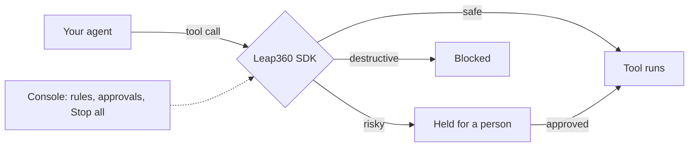

<div align="center">

# Leap360 AI

**Access control for AI agents.** Check every tool call before it runs.

[](https://www.npmjs.com/package/leap360)
[](https://pypi.org/project/leap360)
[](LICENSE)
[](https://www.npmjs.com/package/leap360)

[Website](https://leap360.ai) · [Console](https://leap360.ai/dashboard) · [Pricing](https://leap360.ai/pricing) · [TypeScript docs](typescript/README.md) · [Python docs](python/README.md)

</div>

---

AI agents can send email, issue refunds, write to databases and deploy code. Leap360 sits between your agent and its tools and decides, before each call runs, whether to **allow** it, **hold** it for a person to approve, or **block** it. One press of **Stop all** halts every agent in the project.



## Why Leap360

- **Actions, not just prompts.** Guardrails read text; Leap360 checks what the agent is about to *do*.
- **Fast.** Calls your rules allow are decided in your process from cached rules, in about a millisecond.
- **Safe to adopt.** New projects start in **Watch mode**: you see what your rules would do before anything is blocked.
- **A person in the loop.** Risky calls wait for approval in the console or Slack.
- **Works with your stack.** OpenAI Agents SDK, LangGraph, CrewAI, Vercel AI SDK, MCP servers and your own code.

## Install

| Language | Package | Install |
| --- | --- | --- |
| TypeScript / JavaScript | [`leap360`](https://www.npmjs.com/package/leap360) | `npm install leap360` |
| Python | [`leap360`](https://pypi.org/project/leap360) | `pip install leap360` |

Get an API key at [leap360.ai](https://leap360.ai) and set it as an environment variable:

```bash
export LEAP360_API_KEY=your_key
```

## Quick start

**TypeScript**

```ts
import { Leap360 } from 'leap360';

const leap = new Leap360({ apiKey: process.env.LEAP360_API_KEY, serviceName: 'support-bot' });

// Wrap any function your agent can call as a tool
const refund = leap.wrapTool('refund_customer', async (args) => realRefund(args));
```

**Python**

```python
from leap360 import Leap360Governor

leap = Leap360Governor(agent_name="support-bot")  # reads LEAP360_API_KEY

@leap.wrap_tool("refund_customer")
def refund_customer(order_id: str, amount: float):
    ...
```

Run your agent once and its calls appear in the console under **Live activity**. When you are happy with what Watch mode shows, turn on blocking.

**Using a coding agent?** Paste the setup prompt from the console into Claude Code, Cursor or Codex and it wraps your tools for you.

## MCP servers

Put any MCP server behind Leap360 without changing its code:

```bash
npx -y leap360 mcp-proxy --agent claude-code -- npx -y @modelcontextprotocol/server-github
```

## Repository layout

```
typescript/   npm package "leap360" (SDK, CLI, MCP proxy)
python/       PyPI package "leap360"
```

## Contributing

Issues and pull requests are welcome. See [CONTRIBUTING.md](CONTRIBUTING.md). To report a security problem, please follow [SECURITY.md](SECURITY.md) instead of opening a public issue.

## License

[Apache-2.0](LICENSE) © LeapTheLimit
